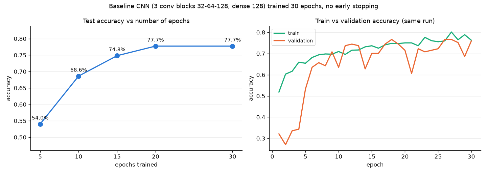
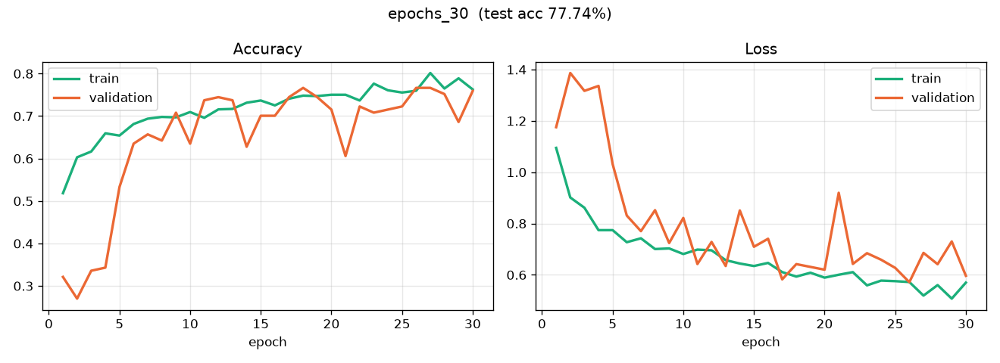
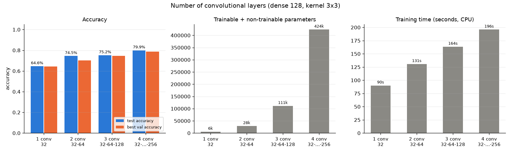
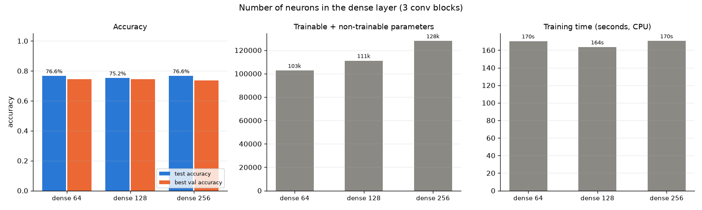
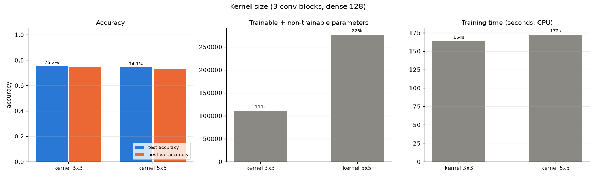
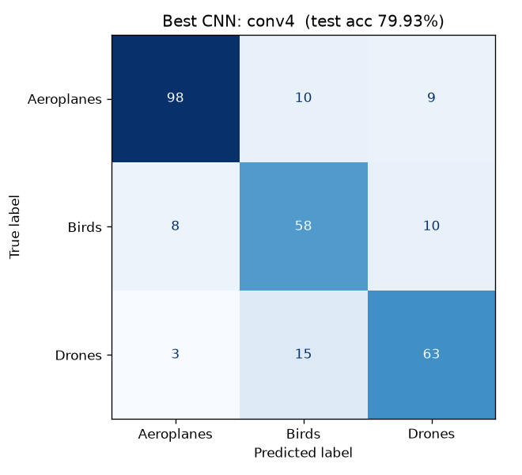
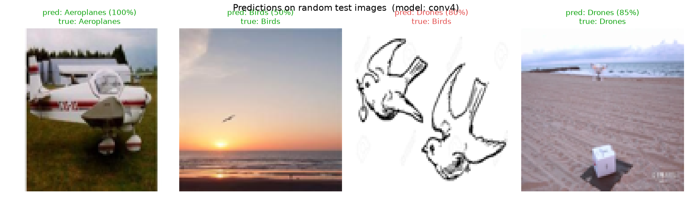
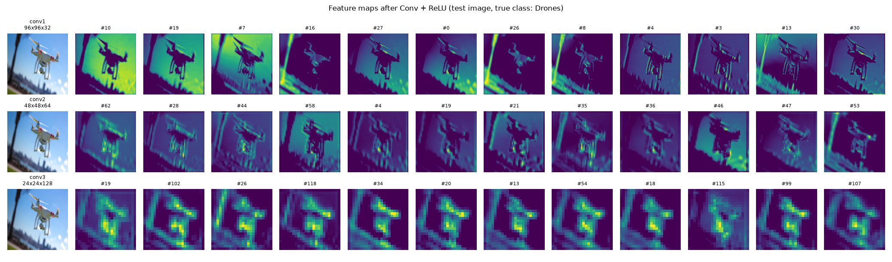
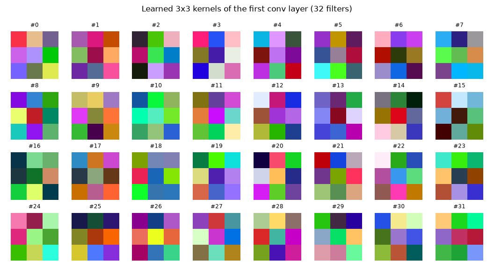

# ML-07-CNN : Convolutional Neural Network

Worksheet 7, Machine Learning (04-624-201), RMUTT.

Build a CNN image classifier in Python (TensorFlow / Keras). The pipeline loads the images, removes duplicates, splits the data into train / validation / test, standardizes the inputs, trains CNNs with different numbers of epochs, convolutional layers, neurons and kernel sizes, then compares their accuracy and shows what the conv layers learn.

# Data

Drone classification Dataset (AirplaneVsDroneVsBird): https://www.kaggle.com/datasets/maryamlsgumel/drone-detection-dataset

This is the same dataset as Labs 4 to 6, so the results can be compared. The images are not copied: `config.py` points to `../ML-06-NN/BirdVsDroneVsAirplane/`. The image files are not on GitHub.

| Step | Aeroplanes | Birds | Drones | Total |
|---|---|---|---|---|
| Readable images | 1010 | 582 | 766 | 2358 |
| After removing exact duplicates (586 removed) and capping at `MAX_PER_CLASS = 582` | 582 | 380 | 406 | 1368 |

Split (stratified, `random_state=42`): **train 957 (70%) / validation 137 (10%) / test 274 (20%)**.

Duplicates are removed **before** the split. Each image is resized to 96x96, the raw pixels are hashed (MD5), and only the first copy of each hash is kept. Without this step the same picture could land in both train and test, and the test score would be too high (data leakage).

# Structure

```text
ML-07-CNN/
├── README.md
├── requirements.txt
└── classification/
    ├── config.py              all settings (IMG_SIZE 96, MAX_PER_CLASS 582, BATCH_SIZE 16, paths)
    ├── main.py                runs the whole pipeline (steps 1-7), resumable
    ├── data_loader.py         finds the classes and skips corrupted images
    ├── preprocessing.py       resize to 96x96, RGB, stored as uint8
    ├── split_data.py          removes duplicates (hash), balances, stratified train/val/test split
    ├── cnn_model.py           build_model(config): Normalization -> augmentation -> n x [Conv+BN+Pool] -> GAP -> Dense
    ├── train_one.py           trains ONE experiment in its own process and writes result.json
    ├── experiments.py         the experiment grid, launches train_one.py per run, writes experiments.csv
    ├── evaluate.py            classification report, confusion matrix, training history plots
    ├── plot_result.py         comparison charts
    ├── visualize_features.py  feature maps of conv layers 1-3 and the learned first-layer kernels
    ├── test_cnn.py            predicts 4 random test images
    └── outputs/
        ├── experiments.csv, best_model.json, classification_report.txt
        ├── *.png              charts (see below)
        ├── experiments/<run>/ result.json, history.json, training_history.png (model.keras not on Git)
        └── logs/              console log of every run
```

# How to run

TensorFlow needs **Python 3.12** (it does not support 3.14). On native Windows TensorFlow runs on the **CPU only**.

```powershell
cd ML-07-CNN
uv venv .venv --python 3.12
.\.venv\Scripts\activate
uv pip install -r requirements.txt
cd classification
python main.py          # about 25 minutes on an i5-11400H
python test_cnn.py      # 4 random test predictions
```

Each experiment runs in its own process so that the RAM (8 GB) is fully freed between runs. A finished run writes `outputs/experiments/<run>/result.json`; if the program stops, run `main.py` again and it continues from where it stopped.

# Model

Same idea as the instructor's model:

```text
Input 96x96x3 (uint8 -> float)
Normalization          standardize: mean 0, std 1 per colour channel, fitted on X_train only
RandomFlip / RandomRotation(0.1) / RandomZoom(0.1)     only active during training
n x [ Conv2D(f, 3x3, same, ReLU) -> BatchNormalization -> MaxPooling2D(2) ]
GlobalAveragePooling2D -> Dropout 0.3 -> Dense(units, ReLU) -> Dropout 0.3 -> Dense(3, softmax)
Adam 1e-3, sparse_categorical_crossentropy
```

**Standardization (worksheet step).** The first layer is `layers.Normalization()`. It is fitted with `adapt()` on **X_train only**, so it learns the mean and variance of each colour channel from the training images and nothing from validation or test (no leakage). Because it is part of the model, the same scaling is used automatically at prediction time. Keeping it inside the model also lets us store the images as `uint8` (4 times less RAM than `float32`).

Experiments B to D use 15 epochs with `EarlyStopping(patience=5, restore_best_weights=True)` and `ReduceLROnPlateau`. Experiment A uses 30 epochs with no early stopping.

# Results

All accuracies are on the **same held-out test set (274 images)**.

### A. Number of epochs (baseline 3 conv 32-64-128, dense 128, one 30-epoch run, test accuracy measured during training)

| Epochs | 5 | 10 | 15 | 20 | 30 |
|---|---|---|---|---|---|
| Test accuracy | 54.01% | 68.61% | 74.82% | **77.74%** | 77.74% |




### B. Number of convolutional layers (dense 128, kernel 3x3)

| Run | Conv blocks | Filters | Params | Train time | Best val acc | **Test acc** |
|---|---|---|---|---|---|---|
| conv1 | 1 | 32 | 5,642 | 90 s | 64.23% | 64.60% |
| conv2 | 2 | 32-64 | 28,490 | 131 s | 70.07% | 74.45% |
| conv3 | 3 | 32-64-128 | 111,050 | 164 s | 74.45% | 75.18% |
| **conv4** | 4 | 32-64-128-256 | 423,626 | 196 s | **78.83%** | **79.93%** |



### C. Number of neurons in the dense layer (3 conv blocks)

| Run | Dense units | Params | Best val acc | Test acc |
|---|---|---|---|---|
| dense64 | 64 | 102,602 | 74.45% | 76.64% |
| conv3 | 128 | 111,050 | 74.45% | 75.18% |
| dense256 | 256 | 127,946 | 73.72% | 76.64% |



### D. (bonus) Kernel size (3 conv blocks, dense 128)

| Run | Kernel | Params | Test acc |
|---|---|---|---|
| conv3 | 3x3 | 111,050 | 75.18% |
| kernel5 | 5x5 | 276,426 | 74.09% |



Per-run training curves: `classification/outputs/experiments/<run>/training_history.png`. Full table: [`experiments.csv`](classification/outputs/experiments.csv).

### Best model: conv4 (chosen by validation accuracy, not by test accuracy)

Test accuracy **79.93%**.

```text
              precision    recall  f1-score   support
  Aeroplanes     0.8991    0.8376    0.8673       117
       Birds     0.6988    0.7632    0.7296        76
      Drones     0.7683    0.7778    0.7730        81
    accuracy                         0.7993       274
```




### Feature maps (what the CNN sees)




### Comparison with earlier labs

| Lab | Model | Input | Test accuracy |
|---|---|---|---|
| 4 | KNN (k=3) | grayscale pixels | 71.67% |
| 5 | SVM (RBF) | grayscale pixels + PCA | 76.48% |
| 6 | NN (MLP) | 64x64 RGB pixels, flattened | 76.72% |
| **7** | **CNN (conv4)** | 96x96 RGB image | **79.93%** |

Note: Labs 4 to 6 did not remove duplicate images and used a different split, so their test sets contain pictures that also appear in training. Their scores are probably a bit too high, and the CNN's real advantage is likely larger than this table shows.

# Summary

- A CNN learns its own features (edges, shapes, textures) from the pixels. KNN, SVM and the MLP only compare raw pixel values. The best CNN (4 conv blocks) reached **79.93%**, the best result of all labs so far, even on a cleaner test set.
- **Epochs:** test accuracy rose quickly from 54% (5 epochs) to 77.7% (20 epochs), then stayed flat up to 30 epochs. Train and validation accuracy stay close together (about 76% at epoch 30), so the model is **not overfitting**. Data augmentation and dropout keep it from memorising, and more epochs simply stop helping after about 20.
- **Conv layers:** more conv blocks gave higher accuracy (64.6% -> 74.5% -> 75.2% -> 79.9%). Each extra MaxPool lets later layers see a larger part of the image. The cost is more parameters (5.6k -> 424k) and longer training (90 s -> 196 s).
- **Neurons:** 64, 128 and 256 dense units all scored about 75-77%. The conv layers do most of the work; the size of the dense head matters little.
- **Kernel size:** 5x5 has 2.5 times more parameters than 3x3 and was not better (74.1% vs 75.2%). Stacking small 3x3 kernels is cheaper, which is the idea behind VGG (Lab 8).
- Birds are the hardest class (F1 0.73). They are small in the image and are sometimes confused with drones.

## สรุป (ภาษาไทย)

- **Convolution**: เลื่อน filter ขนาด 3x3 ไปทั่วรูป แต่ละ filter หาลวดลายหนึ่งแบบ เช่น ขอบ มุม สีท้องฟ้า ผลที่ได้คือ feature map (ดู `feature_maps.png`: ชั้นแรกเห็นขอบโดรนชัด ชั้นที่ 3 เล็กลงเหลือ 24x24 และเป็นลวดลายนามธรรมมากขึ้น)
- **ReLU**: ตัดค่าติดลบให้เป็น 0 ทำให้โมเดลเรียนรู้ความสัมพันธ์ที่ไม่ใช่เส้นตรงได้ บริเวณสีเข้มใน feature map คือจุดที่ถูกตัดเป็น 0
- **Pooling (MaxPool 2x2)**: ย่อ feature map ลงครึ่งหนึ่ง เก็บไว้เฉพาะค่าที่เด่นที่สุด คำนวณน้อยลง และชั้นถัดไปมองเห็นพื้นที่กว้างขึ้น
- **Flatten / GlobalAveragePooling**: แปลง feature map เป็นเวกเตอร์เพื่อส่งให้ Dense ตัดสินคลาส ใช้ GAP (เฉลี่ยแต่ละแผ่นเหลือ 1 ค่า) แทน Flatten เพราะใช้พารามิเตอร์น้อยกว่ามาก
- **Standardize**: ใช้ layer `Normalization` ปรับค่าพิกเซลให้ mean = 0, std = 1 โดยเรียนค่าจาก train อย่างเดียว ไม่ให้ข้อมูล test รั่วเข้าไป
- **ทำไม CNN ชนะ KNN/SVM/NN**: 3 วิธีแรกเทียบพิกเซลดิบทีละจุด ถ้านกขยับไปนิดเดียวพิกเซลก็เปลี่ยนหมด แต่ CNN ใช้ filter ชุดเดียวกันทั้งรูป (weight sharing) จึงหาลวดลายเจอไม่ว่าวัตถุจะอยู่ตรงไหน และใช้พารามิเตอร์น้อยกว่า MLP ที่ต่อทุกพิกเซลเข้ากับทุกนิวรอน
- **ผลการทดลอง epoch**: 5 epoch ได้ 54% (underfitting เรียนยังไม่พอ) พอ 20 epoch ได้ 77.7% แล้วคงที่ถึง 30 epoch เส้น train กับ validation อยู่ใกล้กันจึงไม่ overfit (เพราะมี augmentation + dropout)
- **ผลการทดลองจำนวนชั้น conv**: 1 ชั้น 64.6% → 4 ชั้น 79.9% ชั้นมากขึ้นเรียนลวดลายซับซ้อนได้มากขึ้น แต่พารามิเตอร์เพิ่มจาก 5.6 พัน เป็น 4.2 แสน และเทรนนานขึ้นเท่าตัว
- **ผลการทดลองนิวรอน**: 64/128/256 ได้ใกล้เคียงกัน (75–77%) แปลว่างานหลักอยู่ที่ชั้น conv ไม่ใช่ Dense
- **ลบรูปซ้ำ 586 ใบ** ก่อนแบ่งข้อมูล เพื่อไม่ให้รูปเดียวกันอยู่ทั้งใน train และ test คะแนนจึงเชื่อถือได้มากกว่าแล็ปก่อน

### คำถามทบทวน

1. **ถาม:** Standardize ทำตรงไหน ทำไมใช้แค่ train?  
   **ตอบ:** ใช้ layer `Normalization` เป็นชั้นแรกของโมเดล ปรับให้แต่ละช่องสีมี mean 0, std 1 และเรียนค่าจาก train อย่างเดียว ถ้าใช้ test ด้วยจะเท่ากับแอบดูข้อสอบ
2. **ถาม:** ทำไมเลือก conv4 เป็นโมเดลที่ดีที่สุด?  
   **ตอบ:** เลือกจาก validation accuracy สูงสุด (78.8%) ไม่ได้ใช้ test เลือก test มีไว้รายงานผลครั้งสุดท้ายเท่านั้น (79.9%)
3. **ถาม:** โมเดล overfit ไหม ดูจากอะไร?  
   **ตอบ:** ไม่ overfit เพราะเส้น train กับ validation accuracy อยู่ใกล้กัน (ประมาณ 76% ทั้งคู่ที่ epoch 30) ถ้า overfit train จะสูงขึ้นเรื่อย ๆ แต่ val loss จะเพิ่มขึ้น
4. **ถาม:** ทำไมใช้ GlobalAveragePooling แทน Flatten?  
   **ตอบ:** Flatten ของ 6x6x256 ได้ 9,216 ค่า ต่อกับ Dense 128 จะมีน้ำหนักราว 1.2 ล้านตัว แต่ GAP เหลือ 256 ค่า (ราว 33,000 ตัว) โอกาส overfit จึงน้อยกว่า
5. **ถาม:** Data augmentation ช่วยอะไร?  
   **ตอบ:** ตอนเทรนจะสุ่มพลิก หมุน และซูมรูป โมเดลจึงเห็นรูปหลากหลายขึ้นและไม่จำรูปเดิม ทำงานเฉพาะตอนเทรน ตอนทำนายจะปิดไว้
