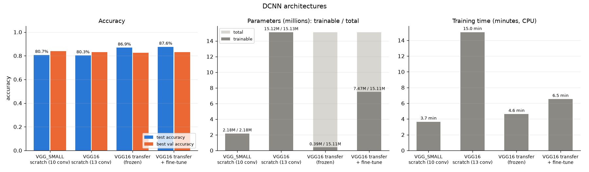
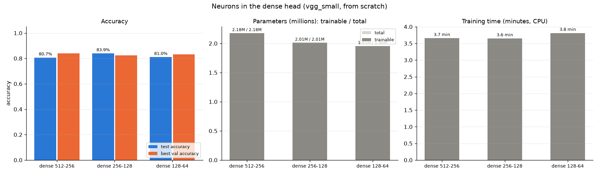
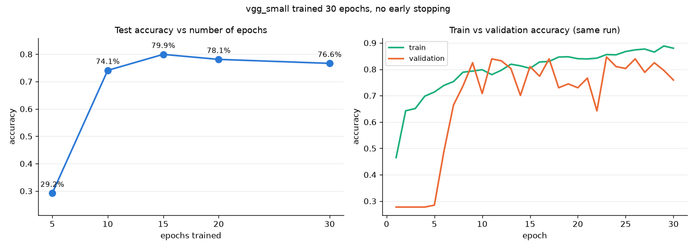
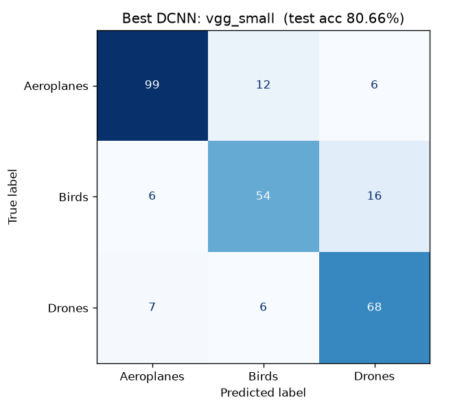
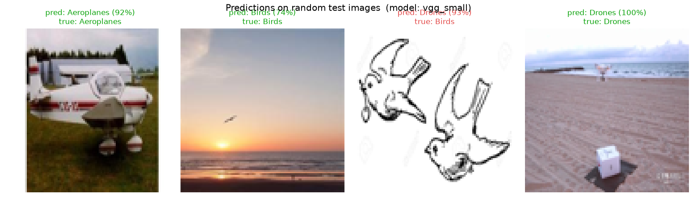
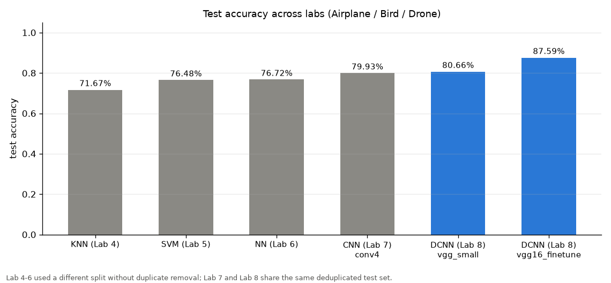

# ML-08-DCNN : Deep CNN (VGG)

Worksheet 8, Machine Learning (04-624-201), RMUTT.

Build deep CNNs in the VGG style and compare them on the same task as Lab 7. The models are trained from scratch with 10 and 13 conv layers, and also built from a pretrained VGG16 (transfer learning and fine-tuning). We compare the number of conv layers, the neurons in the dense head and the number of epochs, and compare the result with all earlier labs.

# Data

Drone classification Dataset (AirplaneVsDroneVsBird): https://www.kaggle.com/datasets/maryamlsgumel/drone-detection-dataset

Exactly the same data pipeline as Lab 7: the same images (`../ML-06-NN/BirdVsDroneVsAirplane/`), the same duplicate removal (586 removed), the same `MAX_PER_CLASS = 582` and the same seed. So the split is identical: **train 957 / validation 137 / test 274**, and Lab 7 and Lab 8 accuracies can be compared directly.

# Structure

```text
ML-08-DCNN/
├── README.md
├── requirements.txt
└── classification/
    ├── config.py              settings (IMG_SIZE 96, SCRATCH_IMG_SIZE 64, BATCH_SIZE 16, LR 1e-4, ...)
    ├── main.py                runs the whole pipeline, resumable
    ├── data_loader.py         (copied from Lab 7)
    ├── preprocessing.py       (copied from Lab 7)
    ├── split_data.py          (copied from Lab 7)
    ├── vgg_model.py           VGG16 / VGG_SMALL blocks, from-scratch builder, transfer builder, fine-tune
    ├── train_one.py           trains ONE experiment in its own process -> result.json
    ├── experiments.py         experiment plan A -> B -> C, writes experiments.csv and choices.json
    ├── evaluate.py            classification report, confusion matrix, history plots
    ├── plot_result.py         comparison charts incl. all-labs comparison
    ├── test_vgg.py            predicts 4 random test images
    └── outputs/
```

# How to run

Uses the same TensorFlow environment as Lab 7 (Python 3.12, CPU).

```powershell
cd ML-08-DCNN\classification
..\..\ML-07-CNN\.venv\Scripts\activate      # or create a new venv from requirements.txt
python main.py          # about 40 minutes on an i5-11400H
python test_vgg.py
```

The ImageNet VGG16 weights (about 58 MB) are downloaded automatically the first time.

# Models

```python
VGG16     = [(64, 2), (128, 2), (256, 3), (512, 3), (512, 3)]   # 13 conv
VGG_SMALL = [(32, 2), (64, 2), (128, 3), (256, 3)]              # 10 conv, lighter for CPU
```

- **VGG block** = n x [Conv2D 3x3 same ReLU + BatchNorm] followed by MaxPool(2).
- **Head** = GlobalAveragePooling -> Dense 512 -> Dropout 0.5 -> Dense 256 -> Dropout 0.5 -> softmax.
- **From scratch**: images are resized to 64x64 inside the model (64 -> 32 -> 16 -> 8 -> 4 -> 2 after 5 pools). `Normalization` is fitted on X_train only (standardization), then augmentation is applied (flip / rotate / zoom).
- **Transfer learning**: `keras.applications.VGG16(weights="imagenet", include_top=False)` at 96x96 is **frozen**, and only the new head is trained (0.39M of 15.1M parameters). For this run the input uses `keras.applications.vgg16.preprocess_input` instead of our own `Normalization`. The pretrained filters were learned on ImageNet images that were converted to BGR and had the ImageNet mean colour subtracted. Our input must look the same, or the learned filters see "wrong" colours.
- **Fine-tune**: start from the transfer model, unfreeze the last block (`block5`, 3 conv layers) and train 5 more epochs with LR 1e-5. The LR is very low so that the pretrained weights only change a little.
- Adam 1e-4, `EarlyStopping(patience=8, restore_best_weights=True)`, `ReduceLROnPlateau(patience=4)`, max 20 epochs, batch 16 (the instructor used 64, which is too much for 8 GB RAM).

# Results

All accuracies are on the **same test set as Lab 7 (274 images)**.

### A. Architectures

| Run | Description | Input | Params (trainable / total) | Epochs | Train time | Best val acc | **Test acc** |
|---|---|---|---|---|---|---|---|
| vgg_small | VGG_SMALL from scratch, 10 conv | 64 | 2.18M / 2.18M | 20 | 3.7 min | **83.94%** | 80.66% |
| vgg16_scratch | VGG16 layout from scratch, 13 conv | 64 | 15.12M / 15.13M | 19 | 15.0 min | 83.21% | 80.29% |
| vgg16_transfer | VGG16 ImageNet, frozen + new head | 96 | 0.39M / 15.11M | 20 | 4.6 min | 82.48% | 86.86% |
| vgg16_finetune | transfer + unfreeze block5, LR 1e-5, +5 epochs | 96 | 7.47M / 15.11M | 20+5 | 6.5 min (total) | 83.21% | **87.59%** |

The VGG16-from-scratch run took 15 minutes (47.5 s/epoch), well under the 2-hour limit, so no data or epochs were cut.



### B. Neurons in the dense head (vgg_small, from scratch)

vgg_small was the better from-scratch model on validation, so it is used here.

| Dense head | Params | Best val acc | Test acc |
|---|---|---|---|
| 512-256 | 2,178,986 | 83.94% | 80.66% |
| 256-128 | 2,014,378 | 82.48% | 83.94% |
| 128-64 | 1,956,650 | 83.21% | 81.02% |



### C. Number of epochs (vgg_small, one 30-epoch run without early stopping)

| Epochs | 5 | 10 | 15 | 20 | 30 |
|---|---|---|---|---|---|
| Test accuracy | 29.20% | 74.09% | **79.93%** | 78.10% | 76.64% |



Per-run curves: `classification/outputs/experiments/<run>/training_history.png`. Full table: [`experiments.csv`](classification/outputs/experiments.csv).

### Best model

The rule is the same as in Lab 7: pick the highest **validation** accuracy, without looking at the test set. The winner is **vgg_small (test 80.66%)**. The 30-epoch run is not a candidate, because it has no early stopping and keeps the last-epoch weights rather than the best ones.

The validation set has only 137 images. One image is 0.73%, so vgg_small (83.94%) beats the fine-tuned VGG16 (83.21%) by a single image. On the test set, which is twice as large, the transfer models are clearly better (86.9% and 87.6% vs 80.7%).

```text
              precision    recall  f1-score   support
  Aeroplanes     0.8839    0.8462    0.8646       117
       Birds     0.7500    0.7105    0.7297        76
      Drones     0.7556    0.8395    0.7953        81
    accuracy                         0.8066       274
```




### Comparison across all labs



| Lab | Model | Test accuracy |
|---|---|---|
| 4 | KNN (k=3) | 71.67% |
| 5 | SVM (RBF) | 76.48% |
| 6 | NN (MLP) | 76.72% |
| 7 | CNN, 4 conv blocks | 79.93% |
| 8 | DCNN VGG_SMALL from scratch (selected by validation) | 80.66% |
| 8 | DCNN VGG16 transfer + fine-tune | **87.59%** |

Labs 4 to 6 used a different split without duplicate removal. Labs 7 and 8 share the same clean test set.

# Summary

- **Deeper from scratch helps only a little.** VGG_SMALL (10 conv) reached 80.7%, close to the Lab 7 CNN (79.9%). VGG16 from scratch (13 conv, 15M parameters) did **not** beat it (80.3%), even though it has 7 times more parameters and took 4 times longer (15 vs 3.7 min). With only 957 training images, a very large network cannot learn all its weights well.
- **Transfer learning wins clearly**: 86.9% with a frozen VGG16 (training only 0.39M parameters, 4.6 min), and **87.6%** after fine-tuning the last block. The ImageNet filters already know edges, textures, wings and sky, so the model needs much less data.
- **Neurons in the head**: 512-256, 256-128 and 128-64 all give 80-84% test accuracy. Shrinking the head barely changes the parameter count (2.18M -> 1.96M), because most parameters are in the conv layers.
- **Epochs**: during the first 5 epochs the validation accuracy is stuck at 28% (one class only), because BatchNorm statistics and the low LR (1e-4) need time to settle. The best test accuracy is at epoch 15 (79.9%). After that, train accuracy keeps rising (to 88%) while validation and test accuracy fall (76.6% at epoch 30). This is **overfitting**, and it shows why EarlyStopping with `restore_best_weights` is used in the other runs.
- Birds remain the hardest class for every model.

## สรุป (ภาษาไทย)

- **CNN กับ DCNN ต่างกันอย่างไร**: DCNN ก็คือ CNN ที่ลึกกว่ามาก Lab 7 ใช้ conv 1–4 ชั้น ส่วน VGG ใช้ 10–13 ชั้น ชั้นลึกขึ้นเรียนลวดลายซับซ้อนขึ้นเป็นลำดับ (ขอบ → รูปทรง → ส่วนของวัตถุ) แต่ต้องใช้ข้อมูลและเวลาเทรนมากขึ้น
- **VGG block**: เอา conv 3x3 มาซ้อนกัน 2–3 ชั้นแล้วปิดด้วย MaxPool ใช้ kernel เล็ก 3x3 ซ้อนกันแทน kernel ใหญ่ เพราะ 3x3 สองชั้นมองเห็นพื้นที่เท่า 5x5 แต่ใช้พารามิเตอร์น้อยกว่า และมี ReLU คั่นหลายครั้ง (ตรงกับผล Lab 7 ที่ kernel 5x5 ไม่ได้ดีกว่า 3x3)
- **ลึกกว่าไม่ได้ดีกว่าเสมอ**: VGG16 เทรนเอง (15 ล้านพารามิเตอร์) ได้ 80.3% ไม่ดีกว่า VGG_SMALL (2.2 ล้าน, 80.7%) แต่ใช้เวลาเทรน 4 เท่า (15 นาที กับ 3.7 นาที บน CPU) ข้อมูลเทรนมีแค่ 957 รูป ไม่พอให้โมเดลใหญ่เรียนรู้น้ำหนักทั้งหมดได้
- **Transfer learning คืออะไร**: ยืม VGG16 ที่ฝึกบน ImageNet มาแล้ว (1.2 ล้านรูป 1,000 คลาส) ชั้น conv ของมันหาขอบ พื้นผิว และรูปทรงเป็นอยู่แล้ว เรา **แช่แข็ง (freeze)** ชั้นพวกนี้ไว้ แล้วเทรนเฉพาะหัว Dense ใหม่ 3 คลาส เทรนแค่ 0.39 ล้านพารามิเตอร์ใน 4.6 นาที ได้ 86.9%
- **Fine-tune**: หลัง transfer แล้วปลดล็อกเฉพาะ block สุดท้ายของ VGG16 ให้ปรับเข้ากับรูปเครื่องบิน/นก/โดรน ใช้ learning rate ต่ำมาก (1e-5) เพื่อไม่ให้ความรู้เดิมพัง ได้ **87.6%** ดีที่สุดของทุกแล็ป
- **ทำไม transfer ใช้ preprocess_input แทน Normalization**: VGG16 ถูกสอนด้วยรูปที่สลับสีเป็น BGR และลบค่าสีเฉลี่ยของ ImageNet ถ้าป้อนรูปที่ปรับคนละแบบ filter ที่เรียนมาจะเห็นสีผิดและทำงานได้ไม่เต็มที่
- **พารามิเตอร์กับความเร็ว** (ตรงกับตารางเปรียบเทียบโมเดลในสไลด์): VGG16 มีพารามิเตอร์มากและช้า โมเดลยุคใหม่อย่าง ResNet, MobileNet และ EfficientNet ได้ความแม่นใกล้เคียงหรือดีกว่าด้วยพารามิเตอร์ที่น้อยกว่ามาก ในงานนี้ VGG_SMALL เร็วกว่า VGG16 4 เท่าและแม่นพอ ๆ กัน
- **ผลการทดลอง epoch**: 5 epoch ได้แค่ 29% (ยังเรียนไม่ทัน) สูงสุดที่ epoch 15 (79.9%) จากนั้น train ขึ้นถึง 88% แต่ test ลดเหลือ 76.6% ที่ epoch 30 = **overfitting** ชัดเจน จึงต้องใช้ EarlyStopping

### คำถามทบทวน

1. **ถาม:** ทำไมโมเดลที่เลือกเป็น vgg_small ทั้งที่ fine-tune ได้ test สูงกว่า?  
   **ตอบ:** เลือกจาก validation เท่านั้นเพื่อให้ test เป็นกลาง val มีแค่ 137 รูป สองตัวต่างกันแค่ 1 รูป (83.94% กับ 83.21%) ส่วน test ที่ใหญ่กว่า 2 เท่าบอกว่า transfer ดีกว่าจริง จึงรายงานทั้งสองค่า
2. **ถาม:** freeze คืออะไร ทำไมต้อง freeze?  
   **ตอบ:** คือไม่ให้น้ำหนักชั้นนั้นเปลี่ยนตอนเทรน (`trainable = False`) ถ้าไม่ freeze ตั้งแต่แรก หัว Dense ที่ยังสุ่มอยู่จะส่ง gradient ใหญ่ ๆ ย้อนกลับไปทำลายน้ำหนักดี ๆ ที่เรียนมาจาก ImageNet
3. **ถาม:** ทำไม VGG16 เทรนเองถึงใช้รูป 64x64 แต่ transfer ใช้ 96x96?  
   **ตอบ:** เทรนเองบน CPU ต้องคำนวณทุกชั้น 64x64 จึงเร็วพอ (ผ่าน MaxPool 5 ครั้งเหลือ 2x2) ส่วน transfer แช่แข็ง conv ไว้ จึงใช้รูปใหญ่ขึ้นให้เห็นรายละเอียดได้มากขึ้น โดยยังเร็วพอ
4. **ถาม:** BatchNormalization ช่วยอะไร?  
   **ตอบ:** ปรับค่าที่ออกจากแต่ละชั้นให้มี mean/std คงที่ ทำให้เทรนโมเดลลึกได้เสถียรขึ้น แต่ช่วงแรกค่าสถิติยังไม่นิ่ง จึงเห็น val ค้างที่ 28% ใน 5 epoch แรก
5. **ถาม:** Dropout 0.5 ในหัว Dense มีไว้ทำไม?  
   **ตอบ:** สุ่มปิดนิวรอนครึ่งหนึ่งในแต่ละรอบการเทรน บังคับไม่ให้โมเดลพึ่งนิวรอนตัวใดตัวหนึ่ง ช่วยลด overfitting ซึ่งสำคัญมากเมื่อข้อมูลน้อย
