# ML-10 : Object Detection II (YOLO)

Worksheet 10, Machine Learning (04-624-201), RMUTT.

Fine-tune a pretrained **YOLO11n** model to detect face masks. The pipeline converts PASCAL VOC annotations to YOLO format, splits the data into train / validation / test, trains with different numbers of epochs, image sizes and batch sizes, evaluates with Precision, Recall, mAP50 and mAP50-95, and runs detection on images, a video and a live webcam.

# Data

Face Mask Detection (andrewmvd): https://www.kaggle.com/datasets/andrewmvd/face-mask-detection

853 images with PASCAL VOC XML annotations. There are 3 classes: `with_mask`, `without_mask` and `mask_weared_incorrect`. The images are not on GitHub. Download the dataset and extract it so the folders are `face-mask-data/images/` and `face-mask-data/annotations/`.

```powershell
curl.exe -L -o face-mask.zip https://www.kaggle.com/api/v1/datasets/download/andrewmvd/face-mask-detection
Expand-Archive face-mask.zip -DestinationPath face-mask-data
```

Split by image (random, seed 42):

| Split | Images | with_mask | without_mask | mask_weared_incorrect |
|---|---|---|---|---|
| train (70%) | 597 | 2313 | 521 | 84 |
| val (20%) | 170 | 650 | 158 | 30 |
| test (10%) | 86 | 269 | 38 | 9 |

The classes are very imbalanced: there are 27 times more `with_mask` boxes than `mask_weared_incorrect` boxes.

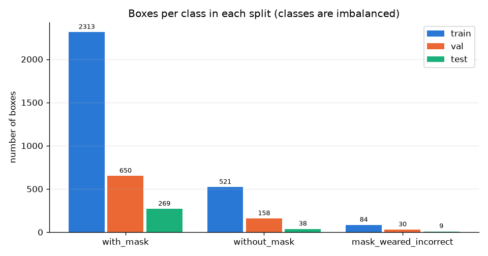

# Structure

```text
ML-10-Object-Detection-II/
├── README.md
├── requirements.txt
├── common.py                    shared settings: paths, classes, experiment table, unicode-safe imread/imwrite
├── main.py                      runs steps 01 -> 05 one after another (resumable)
├── face-mask-data/              raw data (not on Git): images/, annotations/
├── yolo-dataset/                created by step 01 (not on Git): images/{train,val,test}, labels/{...}, data.yaml
├── 01-prepare-data/
│   ├── voc_to_yolo.py           VOC box (x_min, y_min, x_max, y_max) -> YOLO (class, x_c, y_c, w, h) in 0-1
│   ├── main.py                  converts all XML files, splits 70/20/10, writes data.yaml
│   └── outputs/                 class_distribution.png, sample_gt_boxes.png, split_summary.txt
├── 02-pretrained-yolo/
│   ├── main.py                  pretrained COCO model on test images, before fine-tuning
│   └── outputs/
├── 03-train-yolo/
│   ├── main.py                  experiment grid, one run per process, retries with half batch on CUDA OOM
│   ├── train_one.py             trains one run (model.train)
│   └── outputs/experiments/<run>/   results.csv, results.png, curves, args.yaml (weights/ not on Git)
├── 04-evaluate/
│   ├── main.py                  model.val(split="test") for every run -> metrics.csv, picks the best run
│   ├── plot_result.py           comparison charts and loss curves
│   └── outputs/
└── 05-inference/
    ├── detect_images.py         boxes + class + confidence on test images
    ├── detect_video.py          builds a short video from test images (if none is given) and detects every frame
    ├── realtime_camera.py       live webcam detection, press q to quit
    └── outputs/
```

# How to run

YOLO uses PyTorch, which **can use the GPU on Windows** (RTX 3050 Laptop, 4 GB). It needs its own environment, separate from the TensorFlow one used in Labs 7 and 8.

```powershell
cd ML-10-Object-Detection-II
uv venv .venv-yolo --python 3.12
.\.venv-yolo\Scripts\activate
uv pip install torch torchvision --index-url https://download.pytorch.org/whl/cu126
uv pip install -r requirements.txt
python -c "import torch; print(torch.cuda.is_available(), torch.cuda.get_device_name(0))"   # True, RTX 3050

python main.py            # steps 01-05, about 45 minutes
```

### Real-time camera (run it yourself, in front of the webcam)

```powershell
cd ML-10-Object-Detection-II
.\.venv-yolo\Scripts\activate
cd 05-inference
python realtime_camera.py              # built-in webcam
python realtime_camera.py --source 1   # if you have a second (USB) camera
```

A window shows the boxes, class names, confidence and FPS. Press **q** to quit.

### Your own image or video

```powershell
python detect_images.py --source D:\path\to\photo.jpg
python detect_video.py --source D:\path\to\clip.mp4
```

# Experiments

All runs start from `yolo11n.pt` (COCO-pretrained, 2.6M parameters) with `seed=42`, `patience=0` (no early stopping, so every run trains for the full number of epochs), `cache="disk"` and `workers=0`.

| Group | Run | Epochs | imgsz | Batch |
|---|---|---|---|---|
| epochs | e10 | 10 | 640 | 16 |
| epochs | e30 | 30 | 640 | 16 |
| epochs | e60 | 60 | 640 | 16 |
| config | s320_b8 | 30 | 320 | 8 |
| config | s320_b16 | 30 | 320 | 16 |
| config | s640_b8 | 30 | 640 | 8 |
| config | s640_b16 | 30 | 640 | 16 (same settings as e30, so the result is shared) |

# Results

All metrics are on the **test split (86 images, 316 boxes)**, which was never used for training or for choosing the model.

| Run | Epochs | imgsz | Batch | Precision | Recall | mAP50 | mAP50-95 | AP50 with | AP50 without | AP50 incorrect | Train time |
|---|---|---|---|---|---|---|---|---|---|---|---|
| e10 | 10 | 640 | 16 | 0.810 | 0.653 | 0.771 | 0.520 | 0.949 | 0.871 | 0.493 | 2.9 min |
| e30 | 30 | 640 | 16 | **0.906** | **0.786** | **0.863** | **0.582** | 0.944 | 0.896 | 0.750 | 7.5 min |
| e60 | 60 | 640 | 16 | 0.865 | 0.750 | 0.824 | 0.573 | 0.942 | 0.868 | 0.661 | 14.3 min |
| s320_b8 | 30 | 320 | 8 | 0.830 | 0.576 | 0.711 | 0.463 | 0.897 | 0.716 | 0.520 | 4.9 min |
| s320_b16 | 30 | 320 | 16 | 0.571 | 0.694 | 0.666 | 0.455 | 0.903 | 0.688 | 0.407 | 3.5 min |
| s640_b8 | 30 | 640 | 8 | 0.768 | 0.781 | 0.834 | 0.581 | 0.946 | 0.880 | 0.676 | 8.0 min |
| s640_b16 | 30 | 640 | 16 | 0.906 | 0.786 | 0.863 | 0.582 | 0.944 | 0.896 | 0.750 | (= e30) |

Full table: [`04-evaluate/outputs/metrics.csv`](04-evaluate/outputs/metrics.csv).

**Best run: e60**, chosen by the highest **validation** mAP50-95 (0.585). On the test set, e30 scores a little higher than e60. The test set has only 86 images (just 9 `mask_weared_incorrect` boxes), so differences of 1 to 4 points are within noise.

### Epochs

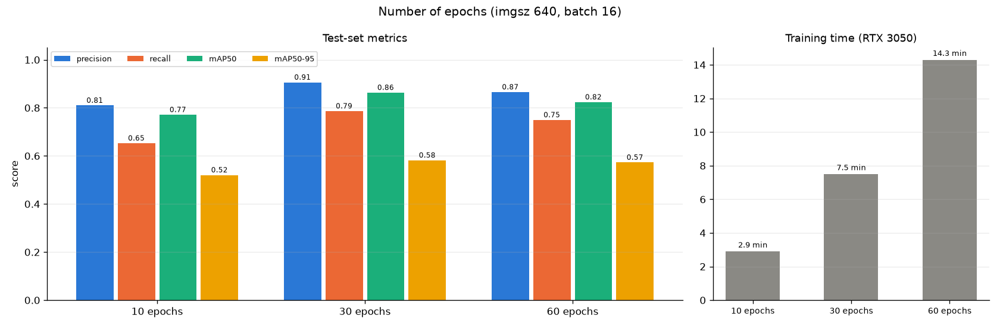
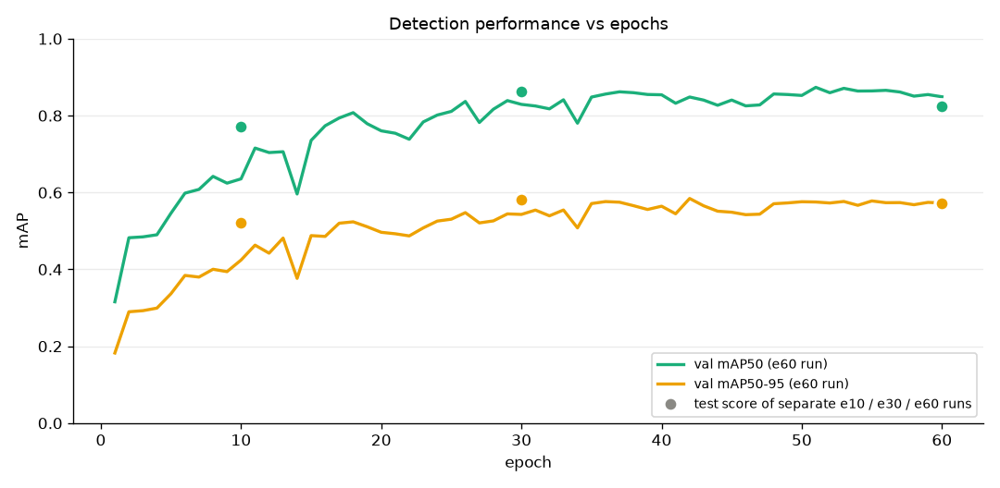

### Image size and batch size

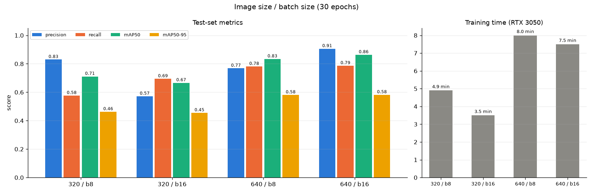

### Training and validation loss (best run)

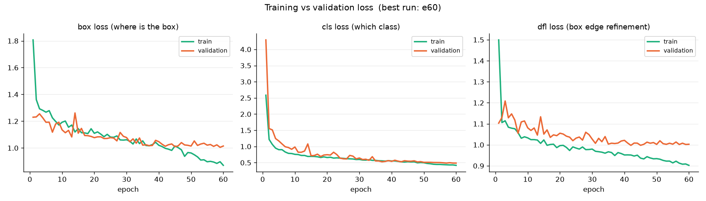
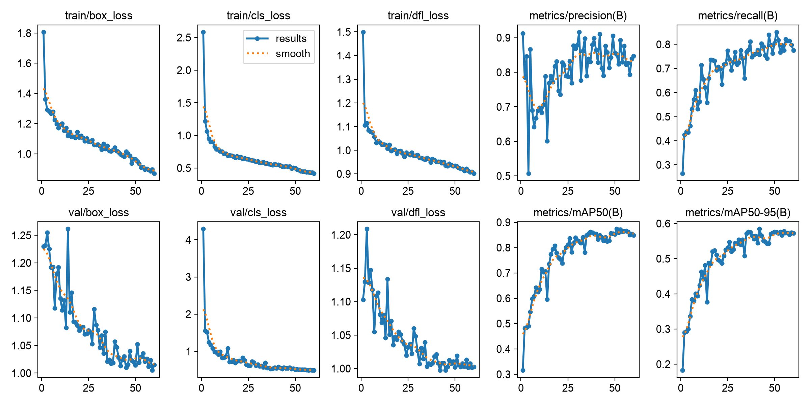

### Confusion matrix and PR curve (best run, test split)

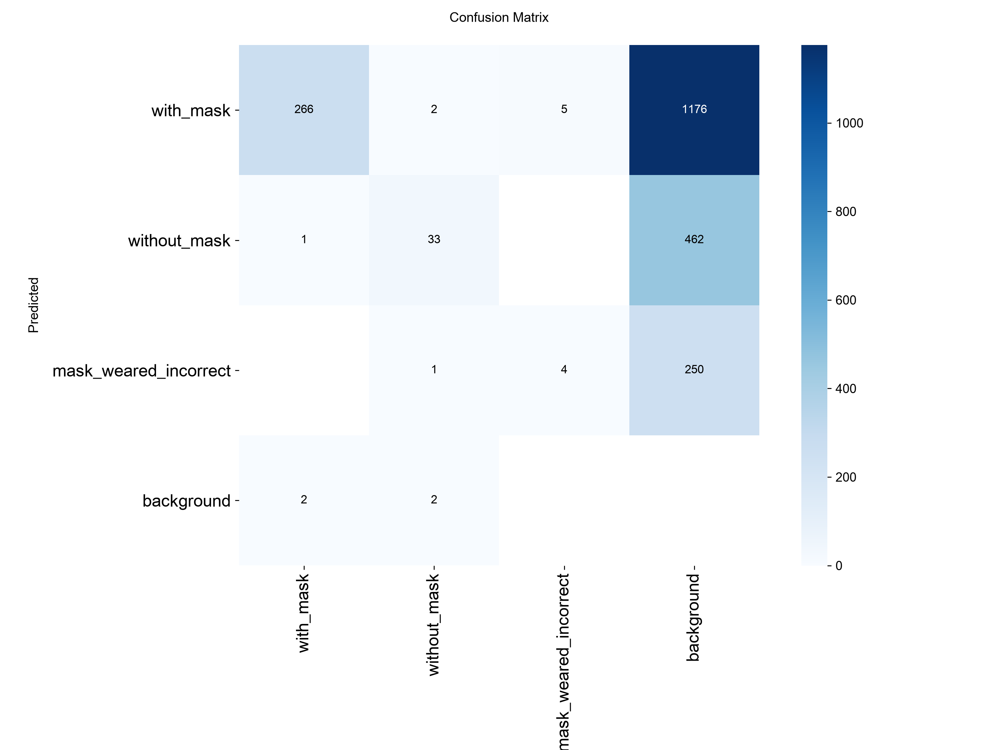
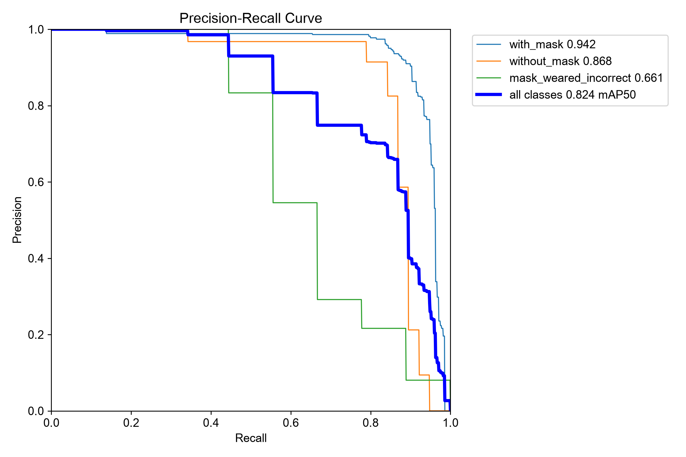

### Before fine-tuning: the pretrained COCO model

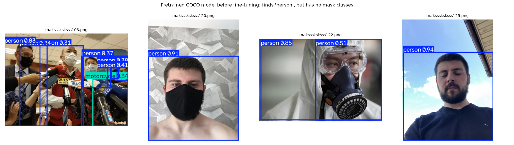

The COCO model has 80 classes and none of them is about masks. It only finds `person` (and one `motorcycle`).

### After fine-tuning: detections with box, class and confidence

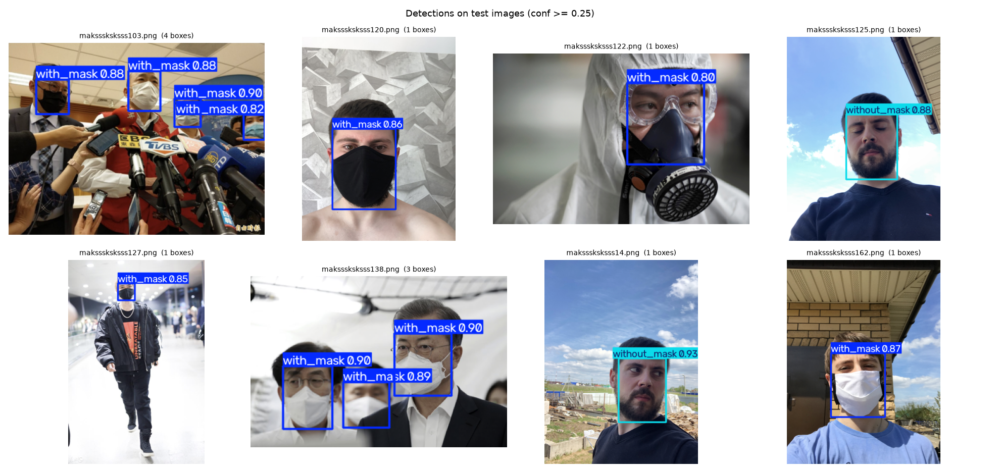

More examples are in `05-inference/outputs/images/`. All 380 boxes found on the test images (with coordinates) are in `05-inference/outputs/detections.csv`.

**Video:** `05-inference/outputs/annotated_video.mp4` (450 frames processed at **41 FPS** on the RTX 3050).

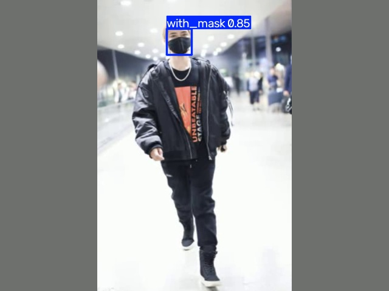

# Summary

- Fine-tuning the COCO-pretrained YOLO11n for 30 to 60 epochs gives **mAP50 0.82-0.86** and **mAP50-95 0.57-0.58** on the test set. Before fine-tuning, the model could not detect any mask class.
- **Epochs:** 10 epochs is too few (mAP50 0.771). The validation mAP rises quickly until about epoch 35, then stays flat. Between epochs 45 and 60 the training box loss keeps falling while the validation box loss does not, which is the start of overfitting. So 60 epochs costs twice the time of 30 epochs and gains nothing.
- **Image size** matters most. Going from 640 to 320 drops mAP50 from 0.83-0.86 to 0.67-0.71. Faces in this dataset are small: at imgsz 640 the median face is about 35 px wide. At 320 it shrinks to about 17 px, and a quarter of the faces are under 11 px, too small for the detector. `without_mask` and `mask_weared_incorrect` suffer the most.
- **Batch size** has a small and inconsistent effect (640: b16 is better; 320: b8 is better). A smaller batch means more update steps, so it takes a bit longer per epoch at 640.
- `with_mask` is easy (AP50 about 0.94 in every run). `mask_weared_incorrect` is hardest (AP50 0.41-0.75) because it has only 84 training boxes and looks very similar to `with_mask`.

## สรุป (ภาษาไทย)

- **Detection ต่างจาก Classification**: classification ตอบได้แค่ "รูปนี้คืออะไร" 1 คำตอบ ส่วน detection ต้องตอบว่า "มีอะไรอยู่ตรงไหนบ้าง" ทุกวัตถุในรูป แต่ละวัตถุมี **กรอบ (box) + คลาส + ความมั่นใจ (confidence)** เช่น `with_mask 0.90`
- **YOLO (You Only Look Once)**: ส่งรูปเข้าโมเดลครั้งเดียว ทายกรอบและคลาสของทุกวัตถุพร้อมกัน จึงเร็วพอใช้กับวิดีโอ (ได้ 41 FPS) YOLO11 แบ่งรูปเป็นกริด แต่ละจุดทายระยะจากจุดนั้นไปถึงขอบกรอบทั้ง 4 ด้านได้ตรง ๆ (anchor-free) ไม่ต้องมีกรอบตั้งต้น
- **IoU**: วัดว่ากรอบที่ทายกับกรอบจริงซ้อนกันแค่ไหน = พื้นที่ที่ซ้อนกัน ÷ พื้นที่รวมของทั้งสองกรอบ ตัวอย่าง: กรอบจริง 100x100 px กรอบที่ทายเลื่อนไปขวา 20 px พื้นที่ซ้อน = 80x100 = 8,000 พื้นที่รวม = 10,000 + 10,000 − 8,000 = 12,000 → **IoU = 0.67**
- **Precision**: ในกรอบที่โมเดลทายมา ถูกกี่ % (ทายมั่วเยอะ = ต่ำ)  **Recall**: หน้าที่มีจริงทั้งหมด โมเดลหาเจอกี่ % (หาไม่เจอ = ต่ำ) เช่น e30 มี P = 0.906 และ R = 0.786 แปลว่ากรอบที่ทายส่วนใหญ่ถูก แต่ยังหาไม่เจอราว 21%
- **mAP50 กับ mAP50-95**: mAP50 นับว่าถูกเมื่อ IoU ≥ 0.5 (กรอบอยู่ประมาณถูกที่ก็ผ่าน) ส่วน mAP50-95 คือค่าเฉลี่ยตอนเกณฑ์ IoU = 0.50, 0.55, … , 0.95 ต้องวางกรอบเป๊ะจริงถึงจะได้คะแนน จึงต่ำกว่าเสมอ (0.86 กับ 0.58)
- **Epoch**: 10 epoch ยังเรียนไม่พอ (mAP50 0.77) ถึงราว 30–35 epoch ก็อิ่มตัว 60 epoch ใช้เวลาเป็นสองเท่าแต่ไม่ดีขึ้น และ train loss ยังลดต่อขณะที่ val loss ไม่ลดแล้ว = เริ่ม overfit
- **imgsz**: 640 ดีกว่า 320 ชัดเจน (mAP50 0.86 กับ 0.67–0.71) เพราะหน้าคนในชุดนี้เล็ก ที่ 640 หน้ากว้างประมาณ 35 px (ค่ากลาง) ถ้าย่อเหลือ 320 จะเหลือแค่ราว 17 px และ 1 ใน 4 เล็กกว่า 11 px โมเดลมองไม่ออก  **batch**: 8 กับ 16 ได้ผลต่างกันไม่มาก และไม่ไปในทางเดียวกัน
- **ทำไมโมเดล COCO (ขั้น 02) หาหน้ากากไม่เจอ**: COCO มี 80 คลาส (person, car, dog, …) แต่ไม่มีคลาสหน้ากาก โมเดลจึงเห็นแค่ "person" ต้องเอาไปเทรนต่อกับข้อมูลหน้ากาก = **transfer learning** แบบเดียวกับ VGG16 ใน Lab 8 คือยืมความรู้เรื่องขอบ รูปร่าง และใบหน้ามาใช้ แล้วสอนเฉพาะคลาสใหม่ จึงใช้รูปแค่ 597 ใบและเทรนไม่กี่นาทีก็ได้ผลดี
- **วิธีรันกล้องเว็บแคม**:
  ```powershell
  cd ML-10-Object-Detection-II
  .\.venv-yolo\Scripts\activate
  cd 05-inference
  python realtime_camera.py
  ```
  กด q เพื่อออก (ถ้าเปิดกล้องไม่ได้ ลอง `python realtime_camera.py --source 1`)

### คำถามทบทวน

1. **ถาม:** แปลง VOC เป็น YOLO อย่างไร?  
   **ตอบ:** VOC เก็บมุมซ้ายบนและมุมขวาล่างเป็นพิกเซล ส่วน YOLO เก็บจุดกึ่งกลาง ความกว้าง และความสูง หารด้วยขนาดรูปให้อยู่ในช่วง 0–1 เช่น รูป 512x366 กรอบ (79,105,109,142) → x_c = 0.184, y_c = 0.337, w = 0.059, h = 0.101 ทดสอบโดยวาดกรอบกลับลงรูป (`sample_gt_boxes.png`) แล้วตรงกับหน้าคนจริง
2. **ถาม:** ทำไมเลือก e60 ทั้งที่ test ของ e30 สูงกว่า?  
   **ตอบ:** เลือกจาก validation mAP50-95 เพื่อไม่ให้ test มีผลต่อการตัดสินใจ ชุด test มีแค่ 86 รูป ต่างกัน 1–4 จุดถือว่าใกล้เคียงกัน
3. **ถาม:** loss 3 ตัวคืออะไร?  
   **ตอบ:** box loss = ตำแหน่งกรอบผิดแค่ไหน, cls loss = ทายคลาสผิดแค่ไหน, dfl loss = ความคมของขอบกรอบ ทั้ง 3 ตัวลดลงทั้ง train และ validation แปลว่าโมเดลเรียนรู้ได้จริง
4. **ถาม:** ทำไม `mask_weared_incorrect` ได้คะแนนต่ำสุด?  
   **ตอบ:** มีข้อมูลน้อยที่สุด (84 กรอบใน train เทียบกับ `with_mask` 2,313 กรอบ) และหน้าตาคล้าย `with_mask` มาก (ใส่หน้ากากแต่ไม่ปิดจมูก)
5. **ถาม:** confidence 0.25 คืออะไร?  
   **ตอบ:** เป็นเกณฑ์ขั้นต่ำในการแสดงกรอบ ถ้าความมั่นใจต่ำกว่า 25% จะไม่วาดกรอบนั้น ถ้าตั้งสูงขึ้น precision จะเพิ่มแต่ recall จะลด
